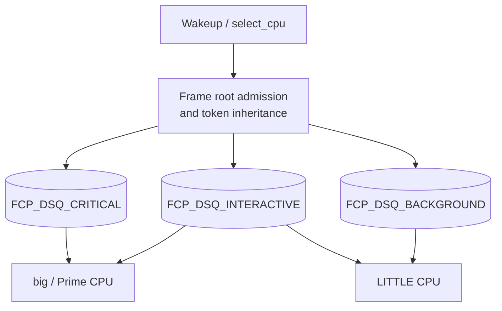

# scx_fcp

## Overview

`scx_fcp` is a frame critical-path `sched_ext` scheduler for heterogeneous
`big.LITTLE` and tri-cluster Android SoCs. It targets VSYNC-driven display
pipelines such as `Input -> UIThread -> RenderThread -> surfaceflinger ->
hwcomposer`, where a slow dependency on a LITTLE core stalls the whole frame.

Frame roots are admitted from observed VSYNC-like wakeup periodicity and an
optional explicit hint set (`default` / `named` profiles). Admitted roots mint
a bounded critical-path token, and synchronous (`SCX_WAKE_SYNC`) or tight
same-process handoffs propagate that token to their wakees.

All scheduling decisions run in BPF (`src/bpf/main.bpf.c`). The userspace
loader (`src/main.rs`) discovers CPU capacity topology across all possible
CPUs, writes BPF `.rodata`, optionally registers frame-root PIDs, attaches the
scheduler through `bpf_struct_ops`, and reports runtime counters.

## How it works

Tasks are classified into three tiers:

- Tier 0 `FCP_TIER_CRITICAL` holds active token holders on the frame critical
  path.
- Tier 1 `FCP_TIER_INTERACTIVE` holds render and ANGLE pool threads, kthreads,
  short high-weight tasks, and recently woken short-running tasks.
- Tier 2 `FCP_TIER_BACKGROUND` holds everything else.

Each tier has a dedicated DSQ (`FCP_DSQ_CRITICAL`, `FCP_DSQ_INTERACTIVE`,
`FCP_DSQ_BACKGROUND`). Critical tasks also use direct local dispatch
(`SCX_DSQ_LOCAL`) and wakeup preemption when a big/Prime CPU is available.



### Behavioral frame-root admission

A task can be promoted to a behavioral frame root after a real sleep block
(never after preemption) when it satisfies all of the following invariants in
`fcp_root_admit_behavior()`:

- **Inter-frame sleep gate**: blocked for at least `1200 us`
  (`FCP_ROOT_SLEEP_GATE_NS`).
- **Sub-frame filter & VSYNC period window**: inter-wake period between
  `3500 us` (`FCP_ROOT_PERIOD_MIN_NS`) and `85000 us`
  (`FCP_ROOT_PERIOD_MAX_NS`); sub-frame wakeups (`< 3.5 ms`) are treated as
  intra-frame blocks rather than new frame epochs, and pauses `> 85 ms`
  preserve root status across idle intervals between user gestures.
- **Bounded frame service**: EWMA runtime of at least `80 us`
  (`FCP_ROOT_MIN_RUNTIME_NS`) and at most `75%` of the period
  (`(period_ns * 3) >> 2`).
- **Causal peer handoff & DAG source invariant**: woke at least one peer thread
  in the preceding burst (`woke_peer > 0`), and was not woken by a non-leader
  peer thread in the same process (`internal_peer_wake`).

Each qualifying wake increments `periodicity_score` by `2` (capped at `10`,
`FCP_ROOT_MAX_SCORE`), and a non-qualifying wake decrements it by `1`. Reaching
a score of `2` (`FCP_ROOT_PROMOTE_SCORE`) promotes the thread to a behavioral
root. Continuous CPU-bound execution without waking (`> 100 ms`) demotes a
behavioral root with a `50 ms` cooldown (`FCP_ROOT_COOLDOWN_NS`). Downstream
tasks holding an inherited token are suppressed from self-promoting in the same
epoch.

### Bounded token inheritance

A wake edge in `fcp_token_try_inherit()` is eligible when the waker holds an
unexpired token (`token_expire_ns > now`) and either:

- the wakeup carries `SCX_WAKE_SYNC`, or
- the waker and wakee share the same TGID (`waker->tgid == p->tgid`), the
  waker ran within the stage window (`<= 3.5 ms`, `FCP_SAME_TGID_WINDOW_NS`),
  woke from a real block within the last `15 ms`, and has not yet exhausted its
  per-burst fan-out cap (`woke_peer <= 1`, preventing fan-out storms to worker
  pools).

The wakee inherits the frame's absolute expiration timestamp, increments
`fcp_depth` (`<= MAX_FCP_DEPTH`, `5`), and receives a depth-aware deadline
`now + slice_crit_ns + fcp_depth * 250 us`. Non-root tokens are revoked after
`4.0 ms` of cumulative service (`FCP_REVOKE_SERVICE_NS`) or on a short yield
below `50 us` (`FCP_SHORT_YIELD_NS` when preempted), whereas frame roots retain
their token across preemption within the active frame epoch.

### Placement and dispatch

- **Critical (`FCP_TIER_CRITICAL`)**: prefers an idle big/Prime CPU (warming
  the previous big CPU first, then scanning for the highest-capacity idle big
  core). If no big core is idle, preempts a big CPU running a lower tier via
  `SCX_KICK_PREEMPT`.
- **Interactive (`FCP_TIER_INTERACTIVE`)**: prefers its previous CPU or an idle
  LITTLE/big CPU, falling back to vtime order in `FCP_DSQ_INTERACTIVE`.
- **Background (`FCP_TIER_BACKGROUND`)**: steered to LITTLE cores and
  `FCP_DSQ_BACKGROUND`.
- **Starvation guard**: after `starvation_period` (`128` by default)
  consecutive critical/interactive dispatches on a CPU, `fcp_dispatch` rescues
  one task from `FCP_DSQ_BACKGROUND`.

## Build variants

`build.rs` selects a BPF compile-time profile through `SCX_FCP_BUILD`:

| `SCX_FCP_BUILD` | Binary produced by `build_static.sh` | `sched_ext` ops name | Root admission sources |
| :--- | :--- | :---: | :--- |
| *(unset)* / `default` | `scx_fcp` | `fcp` | Behavioral VSYNC detector + comm allowlist + `--frame-pids` |
| `named` | `scx_fcp_named` | `fcp_nh` | Comm allowlist + `--frame-pids` + behavioral fallback |
| `zero-hint` | `scx_fcp_behavioral` | `fcp_zh` | Pure behavioral VSYNC detector only (`SCX_FCP_ZERO_HINT`) |
| `oracle` | `scx_fcp_oracle` | `fcp_or` | Evaluation oracle build (`SCX_FCP_ORACLE`) |

Additional compile-time ablation flags: `SCX_FCP_NO_TOKEN=1` (disables token
propagation) and `SCX_FCP_NO_FANOUT_CAP=1` (disables the per-burst same-TGID
fan-out cap).

## Platform scope

| Target | Kernel / ABI | Architecture | Repository |
| :--- | :--- | :---: | :--- |
| **Android Cuttlefish** (`4/8/16/32` vCPUs) | Android GKI `6.12` / `6.18` / mainline `7.2` | `x86_64` | This repository (`scx_fcp` + `scx`) |
| **Qualcomm SA8155P** (`4+3+1` Kryo 485) | Android 14 GKI `6.1.145` + `sched_ext` backport | `aarch64` | [`trieu1162000/scx-6.1`](https://github.com/trieu1162000/scx-6.1) |

## Options

- `-f`, `--frame-budget-us`: frame budget used for token TTL and deadlines
  (default `16667` for 60 Hz; use `11111` for 90 Hz and `8333` for 120 Hz).
- `-c`, `--slice-crit-us`: critical slice in microseconds (default `2000`).
- `-i`, `--slice-intr-us`: interactive slice in microseconds (default `3000`).
- `-b`, `--slice-bg-us`: background slice in microseconds (default `6000`).
- `--big-cpus`: comma-separated big or Prime CPU IDs (e.g.
  `--big-cpus 16,17,18,19,20,21,22,23,24,25,26,27,28,29,30,31`). If omitted,
  reads `/sys/devices/system/cpu/cpu*/cpu_capacity` and falls back to the upper
  half of the possible CPU set.
- `--frame-pids`: comma-separated thread IDs added to `frame_root_pids`
  (rejected by the `zero-hint` build).
- `--no-preempt`: disable wakeup preemption kicks for critical tasks.
- `--starvation-period`: maximum consecutive critical dispatches before rescuing
  one background task (default `128`).
- `-s`, `--stats-interval-s`: telemetry print interval in seconds (default `2`,
  `0` disables periodic printing).

## Repository layout

| Path | Description |
| :--- | :--- |
| `src/bpf/main.bpf.c`, `src/bpf/intf.h` | BPF `sched_ext` implementation (root admission, token propagation, tier placement) |
| `src/main.rs`, `build.rs` | Userspace loader, topology discovery (`libbpf_rs::num_possible_cpus()`), profile builder |
| `scripts/build_static.sh` | Builds static scheduler binaries (`scx_fcp`, `scx_fcp_named`, `scx_fcp_behavioral`), baselines, and `fcp_frame_bench` |
| `tools/scx_fcp_bench/` | Synthetic 4-stage VSYNC display pipeline & background contention benchmark (`fcp_frame_bench`) |
| `tests/jankbench/` | Standalone AOSP `JankBench` (`BM_ID=0..7`, `RUN_COUNT=10`) runner and SQLite analyzer |
| `tests/uibench/` | Standalone AOSP `UiBenchJankTests` runner, `GfxMonitor`/`PROFILEDATA` extractor, and aggregator |
| `tests/synthetic/` | Standalone `fcp_frame_bench` runner for host and Android targets |
| [`artifact/`](artifact/README.md) | End-to-end Artifact Evaluation (AE) reproduction guide and orchestration pipeline (`artifact/pipeline.sh`) |

## Quick build and test

This repository is mounted at `$SCX_ROOT/scheds/rust/scx_fcp` inside an `scx`
workspace.

```bash
# 1. Build static scheduler profiles and fcp_frame_bench
SCX_ROOT=$HOME/workspace/scx scripts/build_static.sh

# 2. Run the synthetic 4-stage VSYNC pipeline benchmark on an Android device
TARGET=device SERIAL=127.0.0.1:6520 BIN_DIR=$PWD/build/bin \
  SCHEDULER_LABEL=scx_fcp_behavioral tests/synthetic/run_fcp_frame_bench.sh

# 3. Run the 8-benchmark AOSP JankBench suite (10 iterations per benchmark)
BIN_DIR=$PWD/build/bin SERIAL=127.0.0.1:6520 \
  tests/jankbench/run_jankbench.sh -p scx_fcp_behavioral -n 1

# 4. Run the AOSP UiBenchJankTests suite (10 iterations per test)
BIN_DIR=$PWD/build/bin SERIAL=127.0.0.1:6520 \
  tests/uibench/run_uibench.sh -p scx_fcp_behavioral -n 1 -r 10
```

For complete environment setup, Cuttlefish `4/8/16/32`-vCPU launch, APK build
instructions, validation rules, and full paper table reproduction, start at
**[`artifact/README.md`](artifact/README.md)**.
