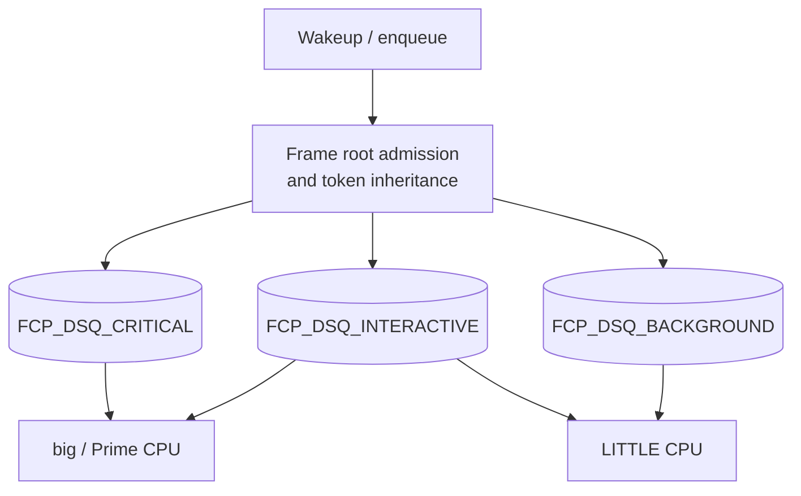

# scx_fcp

## Overview

`scx_fcp` is a frame critical-path sched_ext scheduler for heterogeneous
`big.LITTLE` and tri-cluster Android SoCs. It targets VSYNC-driven display
pipelines such as `Input -> UIThread -> RenderThread -> surfaceflinger ->
hwcomposer`, where a slow dependency on a LITTLE core stalls the whole frame.

This tree is the tuned focus build. Frame roots are admitted from observed
wakeup behavior and an optional explicit hint set. Admitted roots mint a
bounded critical-path token, and synchronous or tight same-process handoffs
propagate that token to their wakees. The decision path does not use thermal
debt, burst-window utilization, or capacity probing. Those mechanisms belong
to earlier revisions and are not part of the tuned build.

All scheduling decisions run in BPF. The userspace loader discovers CPU
capacity topology, writes BPF `.rodata`, optionally registers frame-root PIDs,
attaches the scheduler through `bpf_struct_ops`, and prints counters.

## How it works

Tasks are split into three tiers.

- Tier 0 `FCP_TIER_CRITICAL` holds frame roots and active token holders.
- Tier 1 `FCP_TIER_INTERACTIVE` holds render and ANGLE pool threads, short
  high-weight tasks, and short-sleeping tasks.
- Tier 2 `FCP_TIER_BACKGROUND` holds everything else.

Each tier has a dedicated DSQ. Critical tasks also use direct local dispatch
and wakeup preemption when an idle big core is available.



### Behavioral frame-root admission

A task can become a root after a real block, not after preemption. The
admission rule requires all of the following.

- A sleep of at least `500 us`.
- A period between `3500 us` and `35000 us`.
- Average runtime of at least `80 us` and at most half the period.
- A wakeup that hands work to a peer thread.

The period estimate is an EWMA. A qualifying wake adds 2 to a score capped at
10, a non-qualifying wake subtracts 1, and a score of 7 promotes the task. Two
consecutive missed periods demote a behavioral root. A demoted task cannot
rebuild its score for `50 ms`. The root unit is the thread ID, not the TGID.
Downstream tasks that inherit a token do not promote themselves in the same
epoch.

The default and named builds also accept the legacy comm allowlist and the
`frame_root_pids` map. The zero-hint build disables both hint sources and uses
behavior only.

### Bounded token inheritance

A wake edge is eligible when the waker still holds an unexpired token and the
wake is either marked `SCX_WAKE_SYNC` or stays within the same TGID and occurs
within `1 ms` of the waker's last run. The child inherits the absolute frame
expiry, never extends it, and never lowers an existing depth. Inheritance stops
at depth 3. A token is revoked after `2.5 ms` of service on a real block, or
after a short yield below `50 us`. Token steps run once per wake in
`select_cpu` with the real wake flags.

### Placement and dispatch

- Critical tasks prefer an idle big or Prime CPU. If none is idle, the
  scheduler may preempt a big CPU running a lower tier and kick it with
  `SCX_KICK_PREEMPT`.
- Interactive tasks prefer their previous CPU and then an idle LITTLE CPU,
  with a big idle fallback.
- Background tasks stay on the LITTLE cluster when possible.
- Big CPUs dispatch critical, then interactive, then background. LITTLE CPUs
  dispatch interactive, then background, then critical.
- A starvation guard rescues one background task after 128 consecutive
  critical or interactive dispatches on a CPU.

## Build variants

`build.rs` selects a BPF variant through `SCX_FCP_BUILD`.

| Value | Ops name | Root hints |
|---|---|---|
| unset | `fcp` | comm allowlist and PID map |
| `named` | `fcp_nh` | comm allowlist and PID map |
| `zero-hint` | `fcp_zh` | none, behavior only |
| `oracle` | `fcp_or` | evaluation build |

`SCX_FCP_ANDROID_61` is not part of this mainline tree. The Android 6.1 backport is maintained separately.

## Platform scope

| Target | Kernel / ABI | Architecture |
|---|---|---|
| Android Cuttlefish | Android mainline 6.18 or 7.x | x86_64 |
| SA8155P Android 14 | vendor 6.1.145 with sched_ext backport | ARM64, 4+3+1 |

Verify the booted kernel configuration, BTF, kfuncs, and struct-ops ABI before
attaching on a physical device.

## Options

- `-f`, `--frame-budget-us`: frame budget used for token TTL and deadlines.
  Default `16667` for 60 Hz, use `11111` for 90 Hz and `8333` for 120 Hz.
- `-c`, `--slice-crit-us`: critical slice, default `2000`.
- `-i`, `--slice-intr-us`: interactive slice, default `3000`.
- `-b`, `--slice-bg-us`: background slice, default `6000`.
- `--big-cpus`: comma-separated big or Prime CPU IDs. If omitted, the loader
  reads `cpu_capacity` and falls back to the upper half of the CPU set.
- `--frame-pids`: comma-separated thread IDs added to `frame_root_pids`.
  Rejected by the zero-hint build.
- `-s`, `--stats-interval-s`: telemetry interval, default 2 seconds. Zero
  disables the periodic counters.

## Topology discovery

The loader uses three steps.

1. `--big-cpus` marks the listed CPUs as big with capacity 1024 and all other
   CPUs as LITTLE with capacity 446.
2. Otherwise it reads `/sys/devices/system/cpu/cpu*/cpu_capacity` and marks
   CPUs at or above the midpoint of the observed minimum and maximum as big.
3. On uniform SMP systems it marks the upper half of the online CPUs as big.

## Telemetry

The default build prints three counter lines every stats interval.

```text
[scx_fcp] crit=... intr=... bg=... big=... little=... preempt_kicks=... rescues=...
[scx_fcp] roots beh=... comm=... pid=... prom=... demote=... suppressed=... token_sel=... token_enq=...
[scx_fcp] token issued=... inherited=... edges elig=... inh=... sync=... tgid=... async_rej=... depth_block=... revoke=... expire=... first_big=.../... depth_hist=...
```

The tuning line reports cooldown blocks, edge budget rejects, TGID window
rejects, and capped preemption kicks. The zero-hint build reports zero for the
comm and PID root counters.

## Kernel requirements

- `CONFIG_SCHED_CLASS_EXT=y`
- `CONFIG_DEBUG_INFO_BTF=y`
- `CONFIG_BPF=y`, `CONFIG_BPF_SYSCALL=y`, `CONFIG_BPF_JIT=y`
- `CONFIG_EXT_GROUP_SCHED=y`
- `CONFIG_SCHED_PROXY_EXEC=n` on Android GKI kernels that do not carry the
  sched_ext compatibility patches.

`CONFIG_FUNCTION_TRACER` is optional because the scheduler attaches through
`bpf_struct_ops` and does not use tracefs function filters.

## Build and test

The canonical implementation lives in an `scx` workspace at
`$SCX_ROOT/scheds/rust/scx_fcp`. This repository mirrors that scheduler
directory. Set `SCX_ROOT` to the workspace path.

```bash
# Build statically linked profiles and the synthetic benchmark.
SCX_ROOT=$HOME/workspace/scx scripts/build_static.sh

# Run the synthetic frame pipeline benchmark on the host.
BIN_DIR=$PWD/build/bin SCHEDULER_LABEL=scx_fcp tests/synthetic/run_fcp_frame_bench.sh

# Run a JankBench sample on a connected device.
BIN_DIR=$PWD/build/bin SERIAL=127.0.0.1:6520 \
  tests/jankbench/run_jankbench.sh -p scx_fcp_behavioral -n 1
```

For complete setup, cross-compilation (`x86_64` & `aarch64`), Android bundle packaging, and evaluation instructions, see:
- **[`SETUP.md`](SETUP.md)** — End-to-end build, kernel configuration, Android bundle packaging, and benchmark setup
- **[`artifact/README.md`](artifact/README.md)** — canonical paper build/run/reproduction package
- **[`artifact/BUILD.md`](artifact/BUILD.md)** — scheduler, synthetic bench, and workload APK builds
- **[`artifact/RUN.md`](artifact/RUN.md)** — Cuttlefish setup, 4/8/16/32-vCPU launch, full matrix, validity, analysis

## Use cases

`scx_fcp` is intended for latency-sensitive interactive and display workloads
on heterogeneous multicore systems, including Android phones and tablets,
automotive IVI, and desktop systems with synchronous producer-consumer chains.

It is not intended for throughput-oriented batch or HPC workloads on
homogeneous NUMA servers, or for workloads that require hard cgroup bandwidth
throttling through `cpu.max`.

## FAQ

**Why does a brief helper thread need a token?**

A helper that wakes only once per frame can look light in isolation. If the UI
thread blocks on that helper, the frame waits for wherever the helper runs.
Token inheritance moves the helper to the same critical tier as the frame root
for the remainder of the frame.

**Does a token live forever?**

No. The token expires at the frame budget, is capped at depth 3, and is revoked
after `2.5 ms` of service on a block. A preempted task does not start a new
frame epoch.

**Does the scheduler use thermal debt or burst utilization?**

Not in this build. The tuned decision path uses root state, token state, task
runtime history, CPU capacity class, and idle state. The package description
still carries the original project name.

**How do I mark a custom benchmark thread as a root?**

Use `--frame-pids TID` with the default or named build, or name the thread with
a recognized UI or render prefix. The zero-hint build accepts behavior only.
