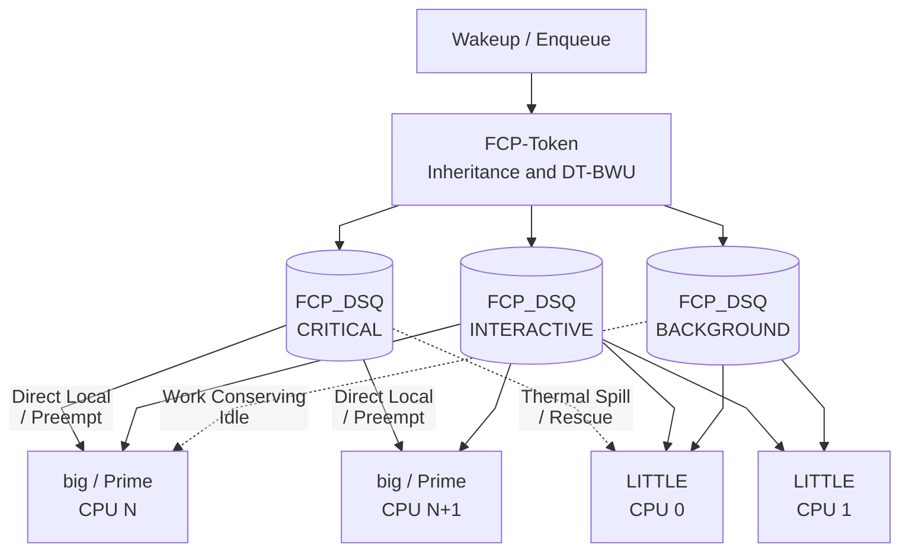

# scx_fcp

## Overview

A Frame Critical-Path & Thermal-Debt Heterogeneous (`big.LITTLE` / tri-cluster) scheduler designed for Android display pipelines and interactive workloads.

The `scx_fcp` scheduler targets heterogeneous mobile and automotive SoCs (such as ARM `big.LITTLE` and tri-cluster `LITTLE` / `Big` / `Prime` architectures) running multi-stage, VSYNC-driven display pipelines (`Input` → `UIThread` → `RenderThread` → `surfaceflinger` → `hwcomposer`). `scx_fcp` combines ephemeral critical-path token propagation across synchronous wakeups, dual-timescale burst-window utilization tracking, and predictive thermal-debt core selection.

All scheduling decisions—wakeup token inheritance, utilization estimation, core selection, preemption kicking, and dispatch queue management—are executed in BPF, while the userspace daemon discovers per-CPU capacity topology (`cpu_capacity` / `cpufreq`), populates BPF `.rodata` and maps, and reports real-time telemetry.

### How it works

`scx_fcp` partitions tasks into three scheduling tiers—**Tier 0 (`FCP_TIER_CRITICAL`)**, **Tier 1 (`FCP_TIER_INTERACTIVE`)**, and **Tier 2 (`FCP_TIER_BACKGROUND`)**—mapped to three dedicated in-kernel dispatch queues (`FCP_DSQ_CRITICAL`, `FCP_DSQ_INTERACTIVE`, and `FCP_DSQ_BACKGROUND`) alongside per-CPU `SCX_DSQ_LOCAL` queues.



`scx_fcp` operates through three coupled mechanisms in BPF:

1. **Ephemeral Frame Critical-Path Token Propagation (`FCP-Token`)**:
   - Frame pipeline roots (`UIThread`, `RenderThread`, `surfaceflinger`, `composer`, `hwuiTask`, `Choreographer`, or PIDs/TGIDs registered via `--frame-pids`) receive a generation-stamped criticality token (`fcp_token_gen`) with a bounded hop depth (`fcp_depth <= MAX_FCP_DEPTH = 4`) and TTL (`frame_budget_ns`).
   - When a task holding an active token wakes a synchronous dependency (`SCX_WAKE_SYNC` or a critical root waking a helper thread over Binder/futex/pipe), `fcp_select_cpu()` and `fcp_enqueue()` propagate the token to the wakee with `fcp_depth + 1`. This eliminates transitive priority inversion when a UI thread blocks on a worker or HAL server.
2. **Dual-Timescale Burst-Window Utilization (`DT-BWU`)**:
   - Standard 32 ms PELT EWMA (`ewma_util`) decays during VSYNC inter-frame sleep intervals (`8–12 ms`), causing waking frame threads to appear falsely light (`util < 250`) at the start of the next frame (**Sleeping-Pipeline Under-Provisioning**).
   - `scx_fcp` maintains a 4 ms sub-frame burst window (`burst_util`) alongside the 32 ms EWMA and computes effective demand as:

     $`\mathbf{effective\_util(p) = \max\left(ewma\_util(p),\ \alpha \cdot burst\_util(p)\right)}`$

     preserving active-phase demand across VSYNC sleep gaps so waking UI stages are immediately placed on high-capacity cores.
3. **Predictive Thermal-Debt Energy-Aware Core Selection (`PTD-EAS`)**:
   - Each CPU tracks an exponentially decaying `thermal_debt` (`0..2048`) scaled by its dynamic power coefficient (`cpu_dyn_power`).
   - On wakeup (`fcp_select_cpu`), Tier-0 (`FCP_TIER_CRITICAL`) and high-demand Tier-1 (`FCP_TIER_INTERACTIVE`) tasks prefer idle `big`/`Prime` cores whose `thermal_debt < thermal_debt_cap`. If all `big` cores are busy, Tier-0 tasks preempt a `big` core currently running a `FCP_TIER_BACKGROUND` task via `scx_bpf_kick_cpu(cpu, SCX_KICK_PREEMPT)`.
   - When a CPU's `thermal_debt` exceeds `thermal_debt_cap`, tasks spill to cooler `big` or `LITTLE` cores (`nr_thermal_spills`), preventing hard hardware thermal throttling cliffs.
   - To guarantee zero starvation under sustained UI load, `fcp_dispatch()` enforces a bounded rescue rule: every 8 consecutive dispatches (`> 7`), if the oldest task in `FCP_DSQ_BACKGROUND` has waited longer than 3 × `frame_budget_ns`, it is rescued before `FCP_DSQ_INTERACTIVE`.

---

## Use Cases

`scx_fcp` is designed for latency-sensitive interactive and display-pipeline workloads on heterogeneous multicore systems, including Android smartphones, tablets, and automotive IVI cockpit systems (such as Qualcomm Snapdragon Automotive `SA8155P` / `SA6155P`), as well as desktop/gaming workloads with synchronous producer-consumer chains.

### Android UI & Automotive Cockpit Workloads

`scx_fcp` automatically detects standard Android display pipeline thread names (`UIThread`, `RenderThread`, `surfaceflinger`, `composer`, `hwuiTask`, `Choreographer`, `android.ui`, `android.anim`, `android.display`) without requiring framework modifications. Relevant options for Android and display workloads:

- `-f` / `--frame-budget-us`: Sets the target VSYNC frame deadline in microseconds (`16667` for 60 Hz, `11111` for 90 Hz, `8333` for 120 Hz). Controls token TTL, vtime deadline scaling, and background starvation rescue thresholds.
- `-c` / `--slice-crit-us`: Time slice for Tier-0 (`FCP_TIER_CRITICAL`) tasks (default `2000` us). Short critical slices prevent long-running tasks from monopolizing `big` cores while allowing sub-frame stages (`0.5–2 ms`) to run to completion without preemption.
- `-i` / `--slice-intr-us`: Time slice for Tier-1 (`FCP_TIER_INTERACTIVE`) tasks (default `3000` us).
- `-b` / `--slice-bg-us`: Time slice for Tier-2 (`FCP_TIER_BACKGROUND`) tasks (default `6000` us).
- `-t` / `--thermal-debt-cap`: Per-CPU thermal debt threshold (`0..2048`, default `850`) before steering tasks away from thermally saturated `big` cores.
- `--big-cpus`: Comma-separated list of `big`/`Prime` CPU IDs (e.g., `--big-cpus 4,5,6,7` on an 8-core `4+3+1` SoC).
- `--frame-pids`: Comma-separated list of additional PIDs/TGIDs to register as explicit Frame Pipeline Roots in the `frame_root_pids` BPF map.

### Big/Little and Tri-Cluster Support

`scx_fcp` automatically discovers heterogeneous core capacities at startup using a four-step fallback:

1. **Explicit CLI override (`--big-cpus`)**: Marks the specified CPUs as `big` (`capacity = 1024`) and remaining CPUs as `LITTLE` (`capacity = 446`).
2. **Sysfs `cpu_capacity`**: Reads `/sys/devices/system/cpu/cpu*/cpu_capacity` (populated by ARM64 device-tree / ACPI `capacity-dmips-mhz`) and classifies cores with capacity $\ge \frac{\min + \max}{2}$ as `big`/`Prime`.
3. **Sysfs `cpufreq` (`cpuinfo_max_freq`)**: On Qualcomm kernels where `cpu_capacity` is not exposed or uniform, reads `/sys/devices/system/cpu/cpu*/cpufreq/cpuinfo_max_freq` and normalizes capacities to `1024` against the maximum cluster frequency (e.g., `SA8155P` Kryo 485: Silver `1.8 GHz` → `633`, Gold `2.4 GHz` → `851`, Prime `2.84 GHz` → `1024`).
4. **SMP fallback**: On uniform SMP systems or virtual machines without `cpu_capacity` or `cpufreq`, assigns the upper half of CPUs as logical `big` cores and the lower half as logical `LITTLE` cores.

### Configuration

`scx_fcp` prints periodic telemetry every `-s` / `--stats-interval-s` seconds (default `2` s; set `-s 0` to disable):

```text
[scx_fcp] crit=59294 intr=155437 bg=60419 tokens_issued=54119 tokens_inherited=31017 preempt_kicks=2512 big=115842 little=151021 therm_spills=0 rescues=0
```

- `crit` / `intr` / `bg`: Enqueue counts across the three tiers.
- `tokens_issued` / `tokens_inherited`: Critical-path tokens minted by frame roots vs. inherited across synchronous wakeups (`FCP-Token`).
- `preempt_kicks`: Number of times a waking critical-path task preempted a background task on a `big` core (`SCX_KICK_PREEMPT`).
- `big` / `little`: Task placements on `big`/`Prime` vs. `LITTLE` cores.
- `therm_spills`: Placements diverted due to `thermal_debt >= thermal_debt_cap`.
- `rescues`: Background tasks rescued from `FCP_DSQ_BACKGROUND` to prevent starvation.

### Kernel Requirements

- **`CONFIG_SCHED_CLASS_EXT=y`** and **`CONFIG_DEBUG_INFO_BTF=y`**:
  - Supported natively on Linux `6.12+` (including Android mainline `6.18` / `7.x`) and on Android GKI `6.1` kernels with the `sched_ext` backport.
- **`CONFIG_SCHED_PROXY_EXEC=n` (or disabled via boot arg `sched_proxy_exec=0`)**:
  - On Android GKI kernel (`android17-6.18`) that didn't carry compatibility Proxy Execution patches, Proxy Execution must be disabled when running `sched_ext` schedulers. Otherwise, there is a kernel panic; see the [Proxy Execution compatibility issue](https://partnerissuetracker.corp.google.com/u/2/issues/580105033).
  - On Android mainline kernel (`android-mainline` aka 7.2), Proxy Execution is disabled when enabling `CONFIG_SCHED_CLASS_EXT` because the guard is still there `depends on !CONFIG_SCHED_CLASS_EXT`.
- **`CONFIG_FUNCTION_TRACER` is optional**:
  - Unlike schedulers that require tracefs `available_filter_functions`, `scx_fcp` runs entirely via `bpf_struct_ops` (`sched_ext_ops`) and works on production Android GKI kernels where `CONFIG_FUNCTION_TRACER` is disabled.

---

## Things you probably shouldn't use `scx_fcp` for

- Purely throughput-oriented, non-interactive batch/HPC server workloads on homogeneous multi-socket NUMA machines where LLC/NUMA pick-2 load balancing (`scx_p2dq`) or flat batch scheduling is preferred.
- Workloads that require hard cgroup CPU bandwidth throttling (`cpu.max`).

## Support

Create an [Issue](https://github.com/sched-ext/scx/issues/new?labels=scx_fcp&title=scx_fcp:%20New%20Issue&body=Kernel%20version:%20(fill%20me%20out)%0ADistribution%20/%20Android%20version:%20(fill%20me%20out)%0AHardware%20/%20SoC:%20(fill%20me%20out)%0A%0AIssue:%20(fill%20me%20out))

## FAQ

- **Why does `scx_fcp` outperform general-purpose schedulers (`EEVDF`, `scx_p2dq`, `scx_lavd`) on asymmetric `big.LITTLE` UI benchmarks?**
  - General-purpose schedulers classify each thread's interactivity in isolation and rely on single-timescale utilization averages. In a multi-stage Android UI pipeline (`UIThread` → `RenderThread` → `Binder/HAL` → `surfaceflinger`), a helper thread that wakes only briefly per frame appears low-utilization and gets placed on a slow `LITTLE` core while the `UIThread` blocks waiting for it. `scx_fcp` propagates the frame root's criticality token across synchronous wakeups (`FCP-Token`) and preserves sub-frame burst demand (`DT-BWU`), steering all dependent critical stages onto `big` cores (`>99%` big-core placement).
- **Why does `scx_fcp` have lower BPF scheduling overhead per syscall than `scx_lavd` and `scx_p2dq`?**
  - `scx_fcp` uses a zero-lookup $O(1)$ fast path in `fcp_select_cpu()` (`scx_bpf_select_cpu_dfl` + cached `tctx->home_cpu`) and lockless direct local dispatch (`SCX_DSQ_LOCAL_ON`) for Tier-1 and Tier-2 tasks, avoiding cross-CPU DSQ lock contention on high-rate wakeup microbenchmarks.
- **How do I run `scx_fcp` for a custom benchmark or game whose thread names don't match Android's UI threads?**
  - Pass the process PID/TGID via `--frame-pids <PID1,PID2>` (or name worker threads with a `UI` / `Render` / `FCP_` prefix). `scx_fcp` will treat those threads as Frame Pipeline Roots and propagate tokens to any helper threads they wake synchronously.
- **Does `scx_fcp` starve background compilation or I/O threads during heavy UI rendering?**
  - No. `FCP_DSQ_BACKGROUND` is work-conserving whenever `big` or `LITTLE` cores are idle, and `fcp_dispatch()` enforces a deterministic starvation bound (3 × `frame_budget_ns`, e.g. `50 ms` at 60 Hz) that rescues aging background tasks even under continuous 100% UI load.
